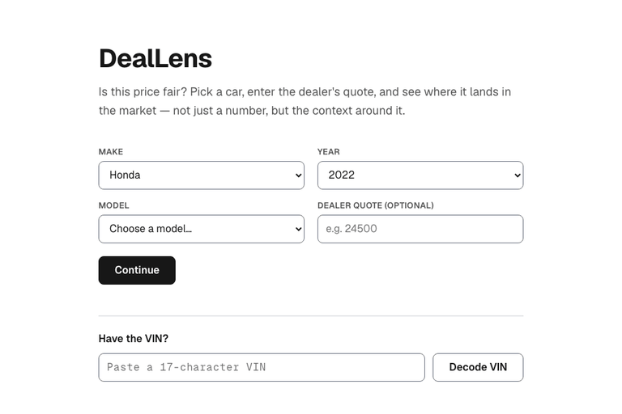

# DealLens — Is this actually a good deal?

**Evidence-backed price intelligence for high-consideration purchases,
starting with used cars.** Research the market, compare citable offers,
see the deterministic math, then get an AI recommendation that is only
allowed to narrate that evidence.

> **Live demo:** [deallens-xi.vercel.app](https://deallens-xi.vercel.app) ·
> **Listing analyzer:** [/research](https://deallens-xi.vercel.app/research) ·
> **Shareable deal dashboard:** [Honda Civic example](https://deallens-xi.vercel.app/deal/honda/2022/civic?quote=24500) ·
> **GraphQL:** [/api/graphql](https://deallens-xi.vercel.app/api/graphql)



## What this is (and is not)

| DealLens is | DealLens is not |
| ----------- | --------------- |
| An evidence-backed research + price intelligence assistant | A car marketplace or dealer inventory site |
| Used cars as the first complete vertical | “Search anything on the entire internet” |
| Controlled listing search (SerpAPI) + honest DEMO fallback | Unauthorized scraping |
| “AI narrates, math decides” | An LLM that invents prices or listings |

## Product surfaces

1. **Listing analyzer (`/research`)** — primary demo path. Enter a listing
   URL or make / model / year / mileage / price. The research pipeline
   collects comparables, explains exclusions, scores the ask with the
   same percentile engine as the dashboard, and optionally writes a
   grounded AI report.
2. **Deal dashboard (`/deal/...`)** — shareable SSR verdict, distribution
   chart, 24-month timeline, Trust Trace, fuel cost. Works with JS
   disabled.
3. **Optional AI extras** on the dashboard (brief + Q&A). Fun-fact and
   contact CRM are demoted; they are not the product story.

## Architecture

```
Browser
  ├─ /research  → POST /api/research → VehicleResearchAdapter
  │                 ├─ ListingCollector (SerpAPI | DEMO fallback)
  │                 ├─ normalize / dedupe / selectComparables
  │                 ├─ domain assessDeal + explainDeal
  │                 ├─ EvidenceBundle → optional AI report
  │                 └─ optional MongoDB session/observation persist
  └─ /deal/...  → GraphQL priceContext (existing car API, unchanged)
                    sources/vpic · fueleconomy · pricing-gen (DEMO)
```

Research types live in [`src/research/`](src/research/). The car GraphQL
schema (`makes`, `models`, `priceContext`, `fuelEconomy`) is **not**
genericized into Product/attribute — a thin `ResearchAdapter` is how a
second vertical (see laptop proof at `POST /api/research/laptop`) plugs in.

## Data honesty

| Source | Status |
| ------ | ------ |
| NHTSA vPIC / EPA fueleconomy | **Real** |
| Listing comparables | **SerpAPI** when `LISTING_SEARCH_API_KEY` or `SERPAPI_API_KEY` is set (`SEARCH_EXTRACTED` + real URLs); otherwise **DEMO fallback** from [`pricing-gen`](src/sources/pricing-gen.ts), labeled |
| Deal-dashboard market sample without research | **DEMO** (deterministic), badge everywhere |
| MongoDB (`MONGODB_URI`) | Optional — immutable observations + reproducible research sessions |

See [ADR 008](docs/adr/008-listing-collector.md) for the collector decision.

## Engineering highlights

- **Isomorphic conclusions** — SSR verdict HTML; Playwright `chromium-no-js`.
- **Trust Trace** — auditable receipt from the same pure `explainDeal` as the hero.
- **AI grounding** — FACTS / EvidenceBundle only; hallucinated listing IDs are stripped.
- **CI gates** — Vitest, Playwright ×3 browsers + no-JS, axe-core WCAG 2.1 AA (light, dark, mobile), Lighthouse (performance ≥ 0.95, accessibility ≥ 0.95), first-load JS budget (≤220 KB gzip per route).
- **Stack** — Next.js 16 App Router, React 19, GraphQL Yoga, D3, TypeScript strict.

## Portfolio / hiring themes

This repo started as an Edmunds-oriented pricing-transparency demo and
grew into a broader **evidence-backed research system**. Interviewers can
still click through performance, isomorphic JS, GraphQL design, and
testing — with the stronger commercial story that recommendations cite
real (or honestly labeled demo) listing evidence.

| Theme | Evidence |
| ----- | -------- |
| Pricing as context | Verdict + distribution + timeline + Trust Trace |
| Evidence pipeline | Listing analyzer, comparables, exclusions, confidence |
| Grounded GenAI | Research report + deal brief; model never invents numbers |
| API design | GraphQL car gateway + `/api/research` research path |
| Persistence with a point | MongoDB for observations/sessions when configured — not bolted onto `priceContext` |
| Extensibility without EAV | `LaptopResearchAdapter` proof route |

## Integrations & API

### External services DealLens calls

| Service | Used for | Auth | If it fails or is not configured |
| ------- | -------- | ---- | -------------------------------- |
| [NHTSA vPIC](https://vpic.nhtsa.dot.gov/api/) | Makes, models per make + year, VIN decode | None | 8 s timeout → classified `UpstreamError`; GraphQL returns `UPSTREAM_TIMEOUT` / `UPSTREAM_UNAVAILABLE`; picker shows "Couldn't reach the vehicle catalog (NHTSA)" |
| [fueleconomy.gov](https://www.fueleconomy.gov/feg/ws/) | EPA combined MPG + weekly national fuel price | None | `fuelEconomy` returns `null` (no forced match); price fields `null`, MPG still shown |
| [SerpAPI](https://serpapi.com/) (Google engine) | Comparable listing search for `/research` | `LISTING_SEARCH_API_KEY` or `SERPAPI_API_KEY` | No key → labeled **DEMO** comparables. Key set but SerpAPI errors (bad key, out of searches) → `502 research_failed` — see [RUNBOOK](docs/RUNBOOK.md#serpapi-errors-or-quota-exhausted) |
| Anthropic Messages API | Deal brief, Q&A, NL finder, fun fact, research report (optional web-search tool, `AI_WEB_SEARCH=0` disables) | `ANTHROPIC_API_KEY` | AI routes return `503` with honest copy; `/api/research` returns the deterministic result with `ai: null` |
| OpenAI audio (`/v1/audio/transcriptions`, `/v1/audio/speech`) | Voice input + spoken replies | `STT_API_KEY` | `GET /api/transcribe` / `GET /api/speak` report `{"enabled": false}`; UI falls back to browser speech or hides the mic |
| MongoDB | Optional persistence of research sessions + price observations | `MONGODB_URI` | No-op when unset; write failures are logged, never fatal |
| Listing page fetch (`/api/research/parse-url`) | Pre-fill the analyzer from a listing URL (JSON-LD, then text) | None (identifies as `DealLensResearchBot`) | `422 fetch_failed` + "enter the details manually"; many dealer sites block bots by design |

Every paid integration has a deterministic mock (`MOCK_AI`, `MOCK_LISTING_SEARCH`, `MOCK_STT`, `MOCK_TTS`) so CI never spends money or flakes on a live model.

### GraphQL — `/api/graphql`

The car data gateway (vPIC + fueleconomy.gov + pricing) behind one schema. Server components call the **same** Yoga instance in-process, so the page and the public API cannot drift. Open [/api/graphql](https://deallens-xi.vercel.app/api/graphql) in a browser for GraphiQL. Full SDL: [`docs/schema.graphql`](docs/schema.graphql) (a unit test fails if it falls out of sync with the served schema).

```bash
curl -s -X POST https://deallens-xi.vercel.app/api/graphql \
  -H 'content-type: application/json' \
  -d '{"query":"query Deal($quote:Int!){ priceContext(make:\"Honda\",model:\"Civic\",year:2022,quote:$quote){ verdict percentile p25 median p75 dataSource } fuelEconomy(make:\"Honda\",model:\"Civic\",year:2022){ combinedMpg fuelType dollarsPerGallon priceSource dataSource } }","variables":{"quote":24500}}'
```

```json
{"data":{"priceContext":{"verdict":"GREAT_DEAL","percentile":0,"p25":28091.25,"median":29545.5,"p75":30375.25,"dataSource":"DEMO"},"fuelEconomy":{"combinedMpg":34,"fuelType":"Regular","dollarsPerGallon":4,"priceSource":"fueleconomy.gov","dataSource":"REAL"}}}
```

Errors carry a machine-readable `extensions.code`: `INVALID_INPUT`, `UPSTREAM_TIMEOUT`, `UPSTREAM_UNAVAILABLE`, `UPSTREAM_FORMAT_DRIFT`, `INTERNAL`.

```json
{"errors":[{"message":"year 1900 is out of range","path":["priceContext"],"extensions":{"code":"INVALID_INPUT"}}],"data":null}
```

### REST routes

All bodies are JSON and validated with zod; errors are `{ "reason": string, "message": string }` with a real status code. AI and voice routes share one per-IP + global rate limiter (`429` with `reason` `ip-minute` / `ip-day` / `global-day`), and send `x-deallens-ai: mock | cache | live`.

| Method + path | Body | Success | Errors |
| ------------- | ---- | ------- | ------ |
| `POST /api/research` | `{ make, model, year, price, mileage?, location?, trim?, listingUrl? }` | `200 { bundle, ai, persisted }` | `400 invalid_json / invalid_input`, `502 research_failed` |
| `POST /api/research/parse-url` | `{ url }` | `200 { partial, warnings }` | `400`, `422 fetch_failed` |
| `POST /api/research/laptop` | `{ title, price }` | `200` second-vertical proof (DEMO catalog) | `400` |
| `POST /api/deal-brief` | `{ make, year, model, quote, target? }` | `200` streamed `text/plain` brief | `400`, `429`, `502`, `503` (no key) |
| `POST /api/deal-ask` | `{ make, year, model, quote, question, turns? }` | `200` streamed `text/plain` answer | `400`, `429`, `502`, `503` |
| `POST /api/find` | `{ query }` (3–300 chars) | `200 { candidates[], dropped }` — each candidate verified against vPIC | `400`, `429`, `502`, `503` |
| `POST /api/fun-fact` | `{ make, year, model }` | `200` `text/plain` | `400`, `429`, `503` |
| `GET / POST /api/transcribe` | audio (≤ 1 MB) | `GET → { enabled }`, `POST → { text }` | `400`, `413`, `429`, `502` (`bad-key` / `no-quota` / `upstream`), `503` |
| `GET / POST /api/speak` | `{ text, style? }` | `GET → { enabled }`, `POST →` audio bytes | `400`, `413`, `429`, `502`, `503` |
| `GET /api/health` | — | `200 { status, version, integrations }`; `?deep=1` also probes vPIC + fueleconomy.gov (`503` if degraded) | — |

Example — research a listing (output trimmed; run locally with `MOCK_LISTING_SEARCH=1 MOCK_AI=1`):

```bash
curl -s -X POST http://localhost:3000/api/research -H 'content-type: application/json' \
  -d '{"make":"Honda","model":"Civic","year":2022,"price":24500,"mileage":42000}'
```

```jsonc
{
  "bundle": {
    "session":   { "id": "…", "status": "COMPLETE", … },
    "target":    { "price": 24500, … },
    "comparables": {
      "included": [ { "title": "2022 Honda Civic LX — $24,000 | 42,100 miles", "price": 24000, "mileage": 42100,
                      "source": { "sourceName": "cars.com", "sourceUrl": "https://…", "dataSource": "SEARCH_EXTRACTED", "extractionConfidence": 0.75 } }, … ],
      "median": …, "p25": …, "p75": …, "sampleSize": 11, "confidence": …, "exclusions": [ … ]
    },
    "verdict": "FAIR", "percentile": 36.4,
    "explainSteps": [ … ], "dataSource": "MIXED", "collectorMode": "LIVE_SEARCH"
  },
  "ai": { "recommendation": "…", "reasoning": "…", "risks": [ … ], "evidenceIds": [ "offer-src-0-…", … ], … },
  "persisted": false
}
```

Health check (what `MOCK_*` CI wiring looks like):

```bash
curl -s http://localhost:3000/api/health
```

```json
{"status":"ok","version":"dev","checkedAt":"2026-11-18T01:20:34.239Z","integrations":{"anthropic":"mock","listingSearch":"mock","openaiVoice":{"transcribe":"mock","speak":"mock"},"mongodb":"off"}}
```

No OpenAPI document yet for the REST routes — the table above is hand-maintained; GraphQL is the typed, self-documenting surface.

## Operations

- **Health:** `GET /api/health` (configured integrations, never key values) and `GET /api/health?deep=1` (live probe of the two keyless government APIs; paid APIs are never probed).
- **Logs:** `/api/research` writes one JSON line per request (`research.completed` / `research.failed` / `research.ai_report_failed` / `research.persist_failed`) with duration, collector mode and the classified upstream error — filter on `event` in Vercel logs. Real line from a local mocked run:

  ```json
  {"ts":"2026-11-18T01:26:00.956Z","level":"info","event":"research.completed","route":"/api/research","durationMs":18,"collectorMode":"LIVE_SEARCH","dataSource":"MIXED","comparables":11,"verdict":"FAIR","persisted":false}
  ```
- **Runbook:** [docs/RUNBOOK.md](docs/RUNBOOK.md) — symptom → check → fix → verify for the failures this project has actually hit.
- **Architecture:** [docs/ARCHITECTURE.md](docs/ARCHITECTURE.md) (Mermaid diagrams). **Demo script:** [docs/DEMO_SCRIPT.md](docs/DEMO_SCRIPT.md).

## Getting started

```bash
npm install
npm run dev
```

Optional env:

| Variable | Purpose |
| -------- | ------- |
| `LISTING_SEARCH_API_KEY` / `SERPAPI_API_KEY` | Live comparable search |
| `MOCK_LISTING_SEARCH=1` | Fixture-shaped search results (CI) |
| `ANTHROPIC_API_KEY` | AI brief / research report / finder |
| `STT_API_KEY` | Whisper STT + TTS |
| `MONGODB_URI` / `MONGODB_DB` | Save research sessions & price observations |
| `MOCK_AI` / `MOCK_STT` / `MOCK_TTS` | Deterministic CI mocks |

| Command | What it does |
| ------- | ------------ |
| `npm test` | Unit + contract tests (Vitest) |
| `npm run test:e2e` | Playwright (build first) |
| `npm run lint` / `npm run typecheck` | ESLint / strict TypeScript |
| `npm run test:a11y` | axe-core accessibility gate (build first) |
| `npx lhci autorun` | Lighthouse budget gate |

## ADRs

- [001 isomorphic D3](docs/adr/001-isomorphic-d3.md)
- [002 URL as state](docs/adr/002-url-as-state.md)
- [003 GraphQL gateway](docs/adr/003-graphql-gateway.md)
- [004 AWS deploy path](docs/adr/004-aws-deploy.md)
- [005 AI narrates, math decides](docs/adr/005-ai-native.md)
- [006 Voice input](docs/adr/006-voice-input.md)
- [007 Trust Trace](docs/adr/007-trust-trace.md)
- [008 Listing collector](docs/adr/008-listing-collector.md)
- [009 MongoDB research persistence](docs/adr/009-mongodb-research.md)
