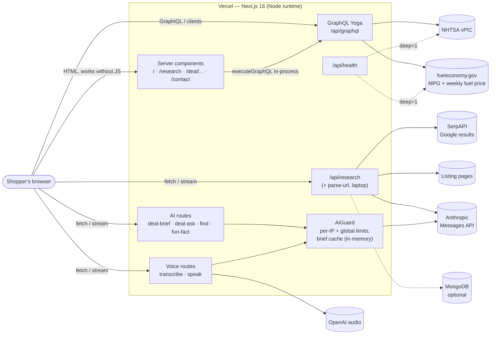
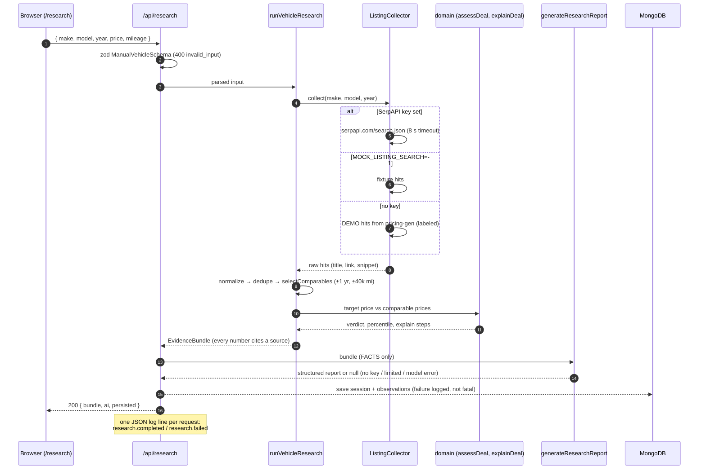
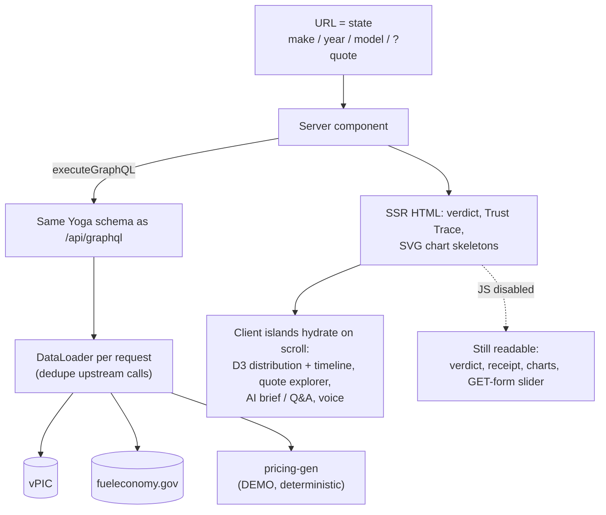
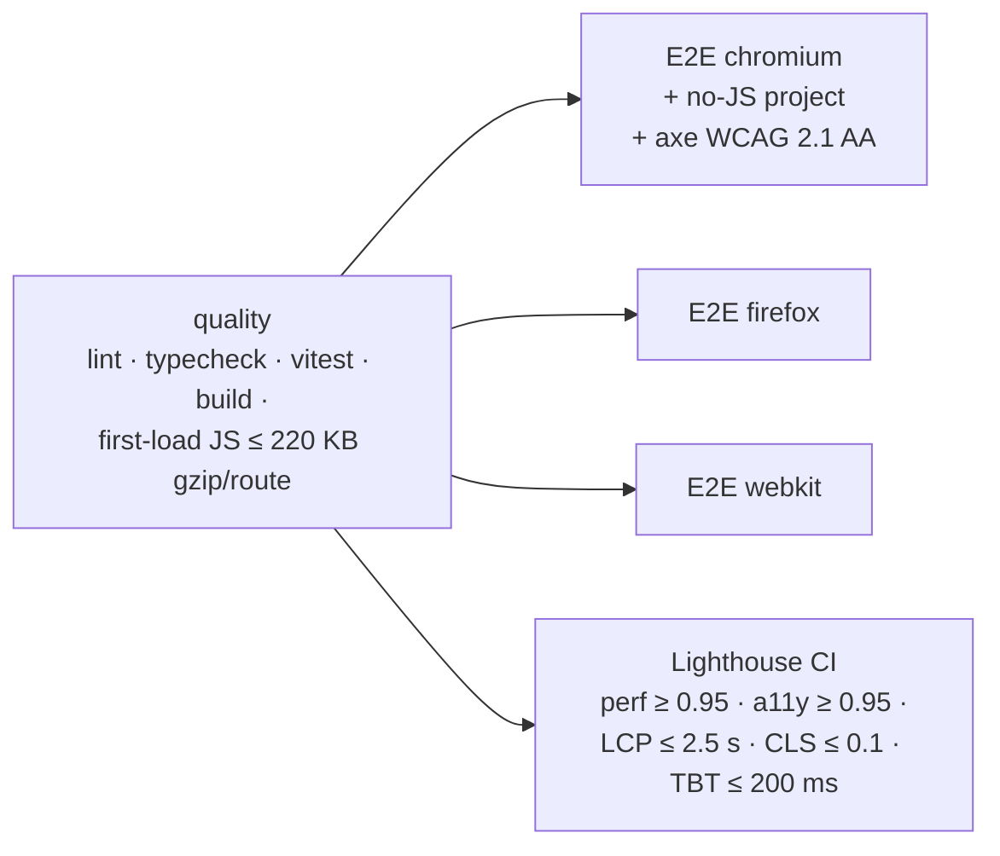

# DealLens architecture

One Next.js 16 App Router app, deployed on Vercel. No separate backend:
route handlers are the API, server components call the same GraphQL
schema in-process, and every external dependency sits behind a module
in `src/sources/`, `src/research/collectors/` or `src/ai/` that can be
mocked by an env flag.

## System context

Dashed lines are optional: MongoDB is a no-op without `MONGODB_URI`;
the deep health probe only runs on request.

## Listing analyzer request (`POST /api/research`)

The verdict is decided in step 7 by pure functions in `src/domain/`
before any model is called. The model only receives the finished
`EvidenceBundle` and its output is validated: evidence IDs that are not
in the bundle are stripped.

## Deal dashboard (`/deal/honda/2022/civic?quote=24500`)

## Where things live

| Concern | Path |
| ------- | ---- |
| Pricing math (pure, unit-tested) | `src/domain/` |
| Upstream clients + error classification | `src/sources/` (`errors.ts`: TIMEOUT / HTTP / FORMAT, secrets redacted from messages) |
| GraphQL schema, resolvers, loaders | `src/graphql/` — SDL published at [`docs/schema.graphql`](schema.graphql) |
| Research pipeline + collectors | `src/research/` |
| AI prompts, grounding facts, rate guard | `src/ai/` |
| Health + structured logs | `src/lib/health.ts`, `src/lib/log.ts` |
| Decisions | [`docs/adr/`](adr/) |

## Quality gates (`.github/workflows/ci.yml`)

All E2E and Lighthouse jobs run against the production build
(`next start`) with every paid integration mocked.
